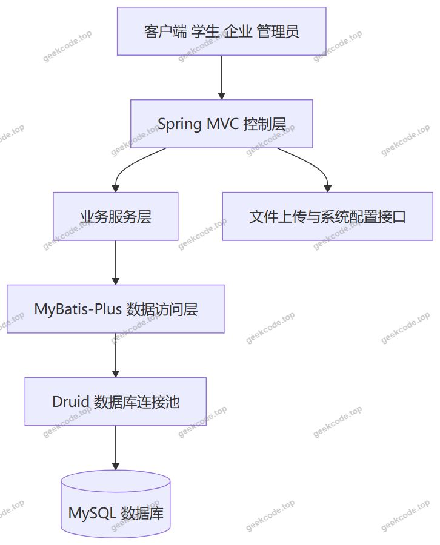
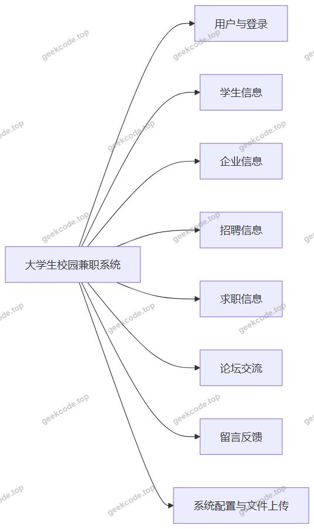
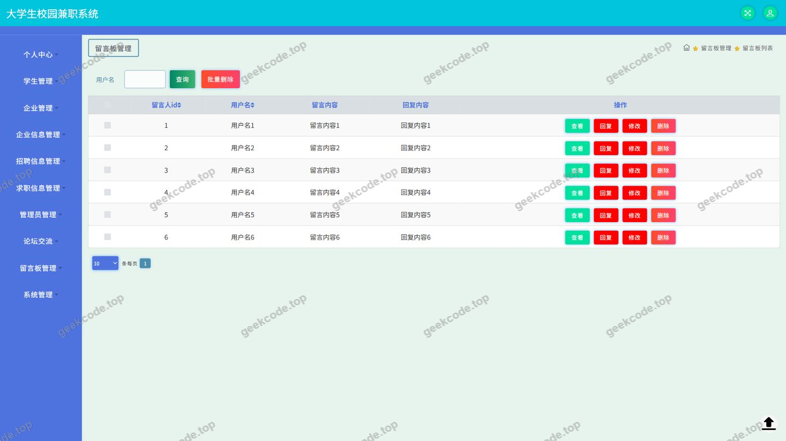
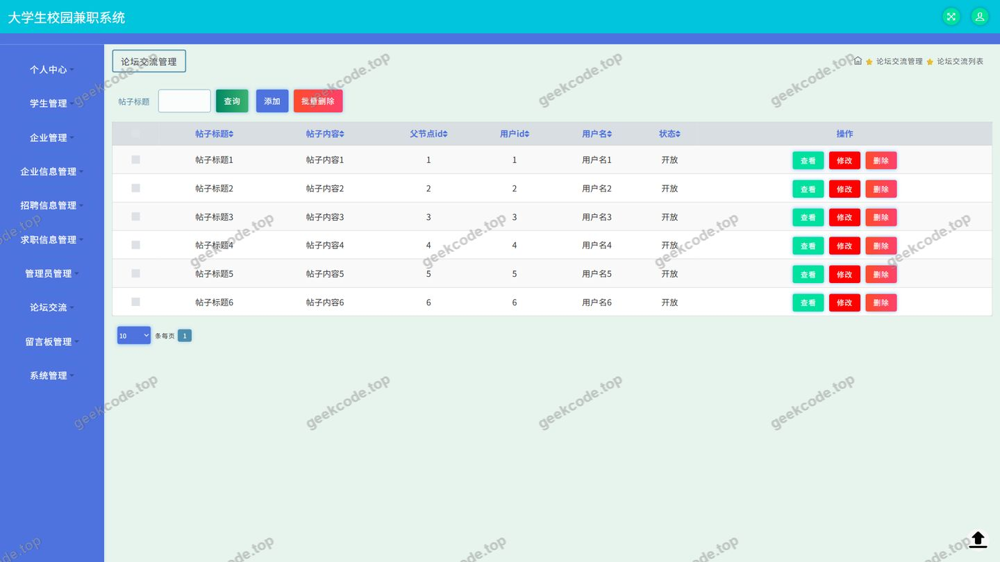
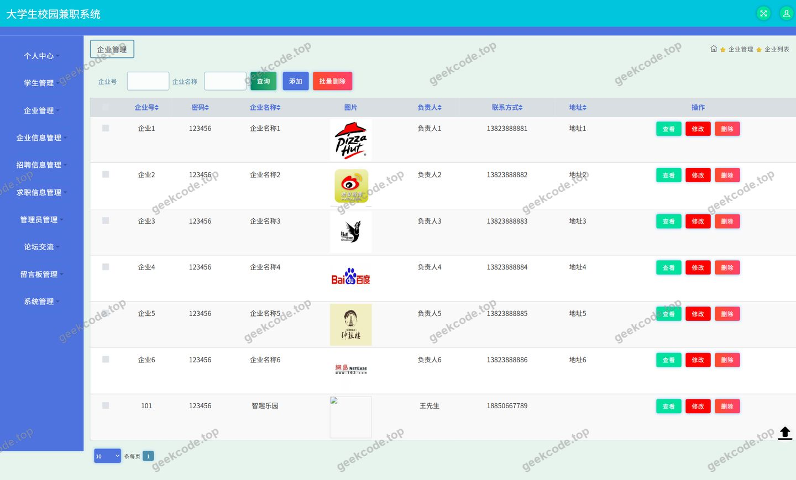
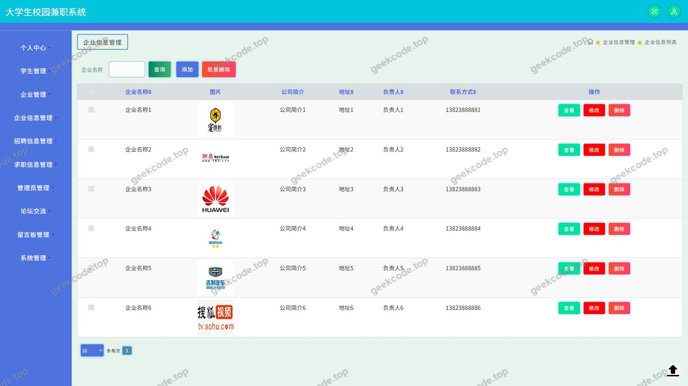
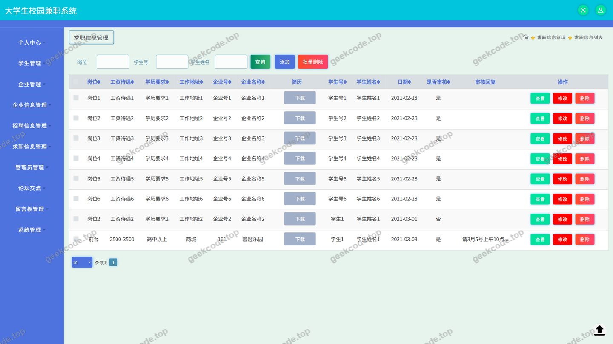
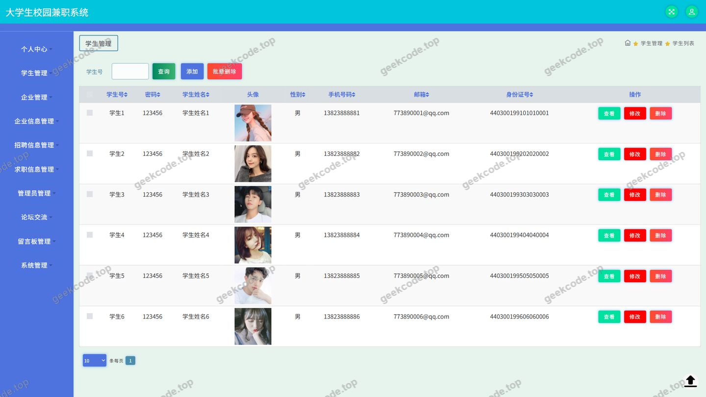
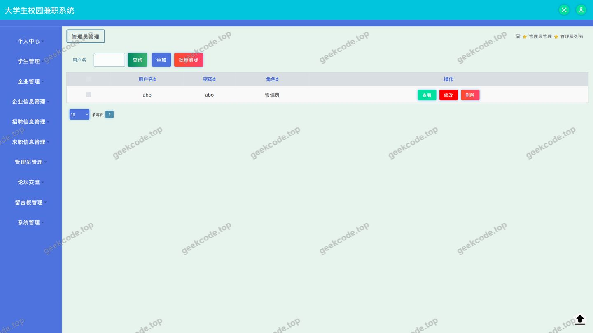
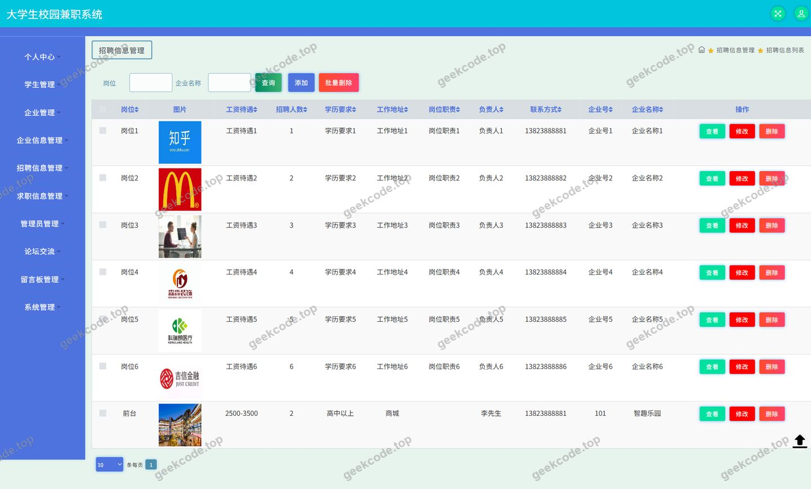

# ssm大学生校园兼职系统-java毕业设计

> 🎓 **计算机毕业设计 · ssm大学生校园兼职系统-java毕业设计**
>
> 本仓库只放**项目介绍 + 运行截图**（截图是站点带水印的原图，存在仓库 `images/` 里）。
>
> 👉 **完整可运行源码 / 数据库脚本 / 部署文档：[点我获取](https://geekcode.top/archives/ssm%E5%A4%A7%E5%AD%A6%E7%94%9F%E6%A0%A1%E5%9B%AD%E5%85%BC%E8%81%8C%E7%B3%BB%E7%BB%9F-java%E6%AF%95%E4%B8%9A%E8%AE%BE%E8%AE%A1?utm_source=github)**
>
> 💬 咨询微信：**ir9372**　|　🌐 更多项目：[极客代码 geekcode.top](https://geekcode.top/?utm_source=github)
>
> 📌 项目详情页：<https://geekcode.top/archives/ssm%E5%A4%A7%E5%AD%A6%E7%94%9F%E6%A0%A1%E5%9B%AD%E5%85%BC%E8%81%8C%E7%B3%BB%E7%BB%9F-java%E6%AF%95%E4%B8%9A%E8%AE%BE%E8%AE%A1?utm_source=github>

<table><td width="230" align="center"> <b>扫码加微信 ir9372</b></td><td valign="middle">📦 源码 = 项目介绍 + 全部运行截图 + 数据库 + 部署文档 👉 点上方任意截图，直接跳到 <b>极客代码 geekcode.top</b> 详情页</td></table>

---

<h1>ssm大学生校园兼职系统-java毕业设计</h1>
<h2>项目概述</h2>

大学生校园兼职系统是一套面向高校学生与用人企业的兼职信息服务平台，采用纯接口方式对外提供数据服务。系统围绕&quot;企业发布招聘、学生发布求职、双方在线交流&quot;这一主线，构建了企业信息、招聘信息、求职信息、论坛交流、留言反馈等核心业务模块，并提供用户、学生、企业等基础数据的管理能力。

平台主要服务于三类人群：寻找兼职机会的在校学生、需要招募兼职人员的校内及周边企业、以及负责平台内容与账号维护的系统管理员。学生可浏览企业招聘信息、发布个人求职意向、在论坛中交流经验并提交留言反馈；企业可维护企业资料、发布与调整招聘岗位、查看学生求职信息。

技术架构上，项目采用 Spring + Spring MVC + MyBatis-Plus 的分层结构，持久层使用 MyBatis-Plus 简化单表增删改查操作，数据库连接由 Druid 连接池统一管理，配合 Spring 的声明式事务保证业务数据一致性；通过统一的控制器层对外暴露接口，并为文件上传与系统配置提供独立支持。

<h2>技术架构</h2>
<h3>整体分层架构</h3>

项目为纯接口类型，控制层直接对外提供数据接口，不包含服务端页面渲染。整体调用链路如下：

<ul>
<li><strong>控制层</strong>：由 CommonController、UserController、XueshengController、QiyeController、QiyexinxiController、ZhaopinxinxiController、QiuzhixinxiController、ForumController、MessagesController、FileController、ConfigController 组成，按照业务实体划分职责，接收请求参数并返回统一格式的数据结果。</li>
<li><strong>业务服务层</strong>：承载兼职信息发布、论坛发帖回帖、留言处理等业务逻辑，并通过 Spring 事务机制（spring-tx、spring-aop）保证写操作的一致性。</li>
<li><strong>数据访问层</strong>：基于 MyBatis-Plus 完成实体映射与条件查询，减少样板式 SQL 的编写量。</li>
<li><strong>连接池</strong>：由 Druid 统一管理数据库连接，提供连接复用与运行状态监控能力。</li>
</ul>
<h3>核心技术选型理由</h3>
<table>
<thead>
<tr>
<th>技术</th>
<th>作用</th>
<th>选型理由</th>
</tr>
</thead>
<tbody><tr>
<td>Spring / Spring MVC</td>
<td>容器管理、依赖注入、请求分发</td>
<td>生态成熟，分层清晰，便于将控制器、服务与数据访问解耦</td>
</tr>
<tr>
<td>MyBatis-Plus</td>
<td>持久层框架</td>
<td>在 MyBatis 基础上内置通用 CRUD 与条件构造器，适合以单表业务为主的兼职信息系统</td>
</tr>
<tr>
<td>Druid</td>
<td>数据库连接池</td>
<td>连接复用效率高，提供监控统计能力，便于答辩演示与运维观察</td>
</tr>
<tr>
<td>spring-tx / spring-aop</td>
<td>事务与切面</td>
<td>以声明式方式管理发帖、留言、信息发布等写操作的事务边界</td>
</tr>
<tr>
<td>spring-context-support</td>
<td>上下文扩展支持</td>
<td>为缓存、任务等通用能力提供容器级支持</td>
</tr>
<tr>
<td>JUnit</td>
<td>单元测试</td>
<td>对服务层与数据访问逻辑进行基础验证</td>
</tr>
</tbody></table>
<h3>数据库设计要点</h3>

依据现有控制器命名，系统的数据实体围绕以下业务对象组织：

<ul>
<li><strong>用户账号类</strong>：用户、学生、企业三类主体各自维护账号与身份信息，学生与企业均通过用户体系完成登录与权限识别。</li>
<li><strong>信息类</strong>：企业信息、招聘信息、求职信息构成核心业务数据。招聘信息由企业发布，求职信息由学生发布，二者在字段上均需包含发布主体、内容描述与发布时间等要素。</li>
<li><strong>互动类</strong>：论坛信息记录帖子与回复内容；留言反馈记录用户提交的意见与处理状态。</li>
<li><strong>支撑类</strong>：系统配置数据由 ConfigController 对应的实体承载；文件记录与上传资源由 FileController 管理。</li>
</ul>

设计上以业务主体为主线建立数据关联，招聘信息与求职信息分别关联企业与学生，论坛与留言关联发帖用户，从而支撑&quot;浏览—发布—互动&quot;的完整链路。

<h2>功能模块</h2>
<h3>前台用户端</h3>
<ul>
<li><strong>登录与用户模块</strong>：提供用户身份识别与账号相关接口，是进入个人中心、发布信息等功能的前提，对应 UserController 与 CommonController。</li>
<li><strong>企业信息模块</strong>：展示企业列表与企业详情资料，供学生了解招募主体的基本情况，对应 QiyeController 与 QiyexinxiController。</li>
<li><strong>招聘信息模块</strong>：展示企业发布的兼职招聘信息，支持按信息内容浏览查看，对应 ZhaopinxinxiController。</li>
<li><strong>求职信息模块</strong>：展示学生发布的求职意向信息，供企业筛选与联系，对应 QiuzhixinxiController。</li>
<li><strong>论坛交流模块</strong>：提供帖子发布与交流互动的接口，为学生之间的兼职经验交流提供场所，对应 ForumController。</li>
<li><strong>留言反馈模块</strong>：接收用户提交的意见与建议，并对留言内容进行记录与管理，对应 MessagesController。</li>
<li><strong>个人中心与我的发布</strong>：登录用户可查看和维护个人资料，并集中管理自己已发布的求职、招聘或帖子内容。</li>
<li><strong>文件上传模块</strong>：为头像、企业资质、信息配图等场景提供统一的文件上传能力，对应 FileController。</li>
</ul>
<h3>管理端</h3>
<ul>
<li><strong>用户管理</strong>：对系统内的用户账号进行查询与维护，对应 UserController 中的管理类接口。</li>
<li><strong>学生管理</strong>：维护学生主体信息，对应 XueshengController。</li>
<li><strong>企业管理</strong>：维护企业主体信息，对应 QiyeController。</li>
<li><strong>企业信息管理</strong>：维护企业详细资料内容，对应 QiyexinxiController。</li>
<li><strong>招聘信息管理</strong>：对企业发布的招聘信息进行审核与维护，对应 ZhaopinxinxiController。</li>
<li><strong>求职信息管理</strong>：对学生发布的求职信息进行管理与维护，对应 QiuzhixinxiController。</li>
<li><strong>论坛信息管理</strong>：对论坛帖子与交流内容进行管理，对应 ForumController。</li>
<li><strong>留言反馈管理</strong>：查看并处理用户提交的留言内容，对应 MessagesController。</li>
<li><strong>系统配置管理</strong>：维护系统运行所需的配置数据，对应 ConfigController。</li>
</ul>

<h2>用户角色与权限</h2>
<h3>学生用户</h3>
<ul>
<li>登录系统并维护个人账号与个人中心资料。</li>
<li>浏览企业信息与招聘信息，查看兼职岗位内容。</li>
<li>发布、修改与删除本人发布的求职信息，通过&quot;我的发布&quot;统一管理。</li>
<li>在论坛中发布帖子并参与交流互动。</li>
<li>提交留言反馈，查看本人留言记录。</li>
<li>上传个人相关文件资源。</li>
</ul>
<h3>企业用户</h3>
<ul>
<li>登录系统并维护企业账号与个人中心资料。</li>
<li>维护本企业的企业信息资料。</li>
<li>发布、修改与删除本企业的招聘信息，通过&quot;我的发布&quot;统一管理。</li>
<li>浏览学生发布的求职信息，获取求职意向。</li>
<li>在论坛中发布帖子并参与交流互动。</li>
<li>提交留言反馈，查看本人留言记录。</li>
<li>上传企业相关文件资源。</li>
</ul>
<h3>系统管理员</h3>
<ul>
<li>用户管理：查询与维护平台用户账号。</li>
<li>学生管理：维护学生主体信息。</li>
<li>企业管理：维护企业主体信息。</li>
<li>企业信息管理：维护企业详细资料。</li>
<li>招聘信息管理：管理企业发布的招聘信息。</li>
<li>求职信息管理：管理学生发布的求职信息。</li>
<li>论坛信息管理：管理论坛帖子与交流内容。</li>
<li>留言反馈管理：查看与处理用户留言。</li>
<li>系统配置管理：维护系统配置数据。</li>
</ul>
<h2>项目特色与创新点</h2>
<ol>
<li><strong>双主体信息撮合</strong>：系统同时支持企业发布招聘信息与学生发布求职信息，形成双向信息流，使学生与企业均可在平台中主动发起连接，而非仅依赖单向岗位发布。</li>
<li><strong>兼职场景的垂直聚焦</strong>：功能设计围绕校园兼职场景展开，涵盖企业资质信息、岗位信息、求职意向与论坛经验交流，贴合学生寻找兼职时关注的核心信息维度。</li>
<li><strong>互动闭环设计</strong>：论坛交流与留言反馈两条通道并存，前者面向学生之间的公开经验分享，后者面向用户与平台之间的意见传达，共同构成信息交互闭环。</li>
<li><strong>统一发布管理入口</strong>：通过&quot;我的发布&quot;将用户在不同模块中产生的发布内容集中呈现，降低用户对自身内容的管理成本。</li>
<li><strong>分层解耦的接口化设计</strong>：全部业务通过控制器对外提供接口，控制层按实体职责拆分，业务层与数据访问层职责边界清晰，便于后续接入不同形态的客户端。</li>
<li><strong>简化持久层开发</strong>：引入 MyBatis-Plus 承担通用单表操作，使开发重心集中在兼职业务逻辑本身，提升代码可读性与可维护性。</li>
</ol>
<h2>部署环境</h2>
<table>
<thead>
<tr>
<th>类别</th>
<th>要求</th>
</tr>
</thead>
<tbody><tr>
<td>JDK</td>
<td>需安装 JDK 并配置 JAVA_HOME，版本与所选 Spring 版本匹配</td>
</tr>
<tr>
<td>数据库</td>
<td>MySQL，需提前创建数据库并导入项目提供的建表与初始化脚本</td>
</tr>
<tr>
<td>构建工具</td>
<td>Maven，用于依赖管理与项目打包</td>
</tr>
<tr>
<td>Web 容器</td>
<td>Servlet 容器（如 Tomcat），用于部署 Spring MVC 应用</td>
</tr>
<tr>
<td>连接池</td>
<td>Druid，通过项目配置文件设置数据库连接参数</td>
</tr>
<tr>
<td>核心框架依赖</td>
<td>spring-core、spring-context、spring-context-support、spring-beans、spring-aop、spring-tx、spring-jdbc、spring-web、spring-webmvc</td>
</tr>
<tr>
<td>持久层依赖</td>
<td>MyBatis-Plus</td>
</tr>
<tr>
<td>测试依赖</td>
<td>JUnit</td>
</tr>
<tr>
<td>开发工具</td>
<td>Java IDE（如 IntelliJ IDEA 或 Eclipse）</td>
</tr>
</tbody></table>
<h2>五、技术特性</h2>
<ul>
<li>使用 MyBatis-Plus 简化数据访问层开发</li>
</ul>
<h2>六、功能模块截图</h2>
<h3>后台管理端</h3>
<h4>页面-登录</h4>

<h4>页面-留言板</h4>

<h4>页面-论坛交流</h4>

<h4>页面-企业</h4>

<h4>页面-企业信息</h4>

<h4>页面-求职信息</h4>

<h4>页面-学生</h4>

<h4>页面-用户</h4>

<h4>页面-招聘信息</h4>

---

## 获取完整源码

| 项目 | 说明 |
| --- | --- |
| 项目名 | ssm大学生校园兼职系统-java毕业设计 |
| 运行截图 | 本文 11 张（站点带水印原图，仓库 `images/` 目录） |
| 完整源码 | [https://geekcode.top/archives/ssm%E5%A4%A7%E5%AD%A6%E7%94%9F%E6%A0%A1%E5%9B%AD%E5%85%BC%E8%81%8C%E7%B3%BB%E7%BB%9F-java%E6%AF%95%E4%B8%9A%E8%AE%BE%E8%AE%A1?utm_source=github](https://geekcode.top/archives/ssm%E5%A4%A7%E5%AD%A6%E7%94%9F%E6%A0%A1%E5%9B%AD%E5%85%BC%E8%81%8C%E7%B3%BB%E7%BB%9F-java%E6%AF%95%E4%B8%9A%E8%AE%BE%E8%AE%A1?utm_source=github) |
| 咨询微信 | **ir9372**（备注：jingpin-yuanma） |
| 更多项目 | [极客代码 geekcode.top](https://geekcode.top/?utm_source=github) |

> 需要源码、部署、改配置、跑不起来等问题，加微信 ir9372 沟通，说明项目名即可。
